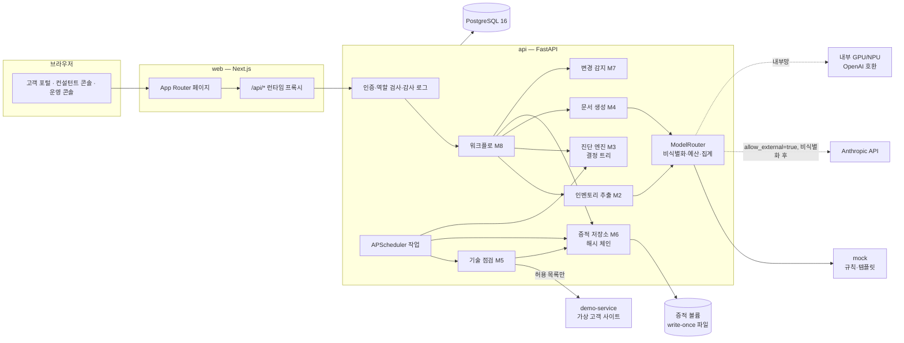

# AI 기본법 준수 플랫폼 (데모)

> **가상 데이터 · 법률 자문 아님.** 이 저장소의 고객사·문서·사례는 모두 가상이며, 법령 내용은 공개 자료를 바탕으로 한 **요약(원문 확인 필요)** 입니다. 판정 결과는 컨설턴트 검토용 초안일 뿐 법적 판단이 아닙니다.

## 1. 목적

DCP의 "AI 기본법 준수 패키지"(진단 → 체계 구축 → 증적 보관 구독)를 뒷받침하는 플랫폼의 동작하는 데모입니다.
사실 수집, 조문 매칭, 문서 초안, 증적 수집, 변경 감지를 자동화하고, **사람(컨설턴트)은 판정 확정과 문서 승인만** 합니다.

운영 환경에서는 고객 자료와 증적이 DCP 국내 데이터센터 안에만 있어야 합니다. 이 데모는 가상 데이터와 공개 법령 요약만 쓰므로 노트북에서 돌릴 수 있습니다.

- 화면별 사용 가이드(용어 풀이, 결과 읽는 법, 고객사 등록, 연습 시나리오로 법 이해하기, 10분 시연 순서, 예상 질문): [`docs/USER_GUIDE.md`](docs/USER_GUIDE.md)
  로그인한 뒤 상단 메뉴 **사용 가이드**(`/guide`)에서도 같은 내용을 볼 수 있습니다. 원본은 `docs/USER_GUIDE.md`이고 앱은 그 사본을 씁니다 — **가이드 수정 후 `scripts/sync_guide.sh` 실행**(아래 5절 참고).
- IDC 서버 구성안(하드웨어·소프트웨어 스택, AI 추론, 보안): [`docs/INFRASTRUCTURE.md`](docs/INFRASTRUCTURE.md)
- 검증 기록: [`docs/VERIFICATION.md`](docs/VERIFICATION.md)

## 2. 기획서 모듈 대응표

| 모듈 | 내용 | 구현 위치 |
|---|---|---|
| M1 법령 지식베이스 | 조문 단위 요약·의무·출처 URL, 버전 관리, AI기본법 ↔ ISMS-P ↔ ISO/IEC 42001 초안 매핑(범주 수준) | `api/app/kb.py`, `api/app/data/kb_v1.json`, `kb_v2_simulated.json`, 화면 `/kb` |
| M2 AI 인벤토리 | 자료(텍스트)+설문에서 AI 시스템과 속성 추출, 모든 사실에 인용(문서 id + 인용 구간) | `api/app/extractor.py`, 화면 `AI 인벤토리` |
| M3 진단 엔진 | 결정 트리(규칙 우선): 사업자 지위, 생성형, 제31조, 고영향 2단계, 제33조 권고, 근거 문장 ↔ 조문·사실 연결, 버전 보관, 컨설턴트 확정 | `api/app/engine.py`, 화면 `판정` |
| 골든셋 | 합성 사례 33건, 일치율 리포트, 90% 미만이면 테스트 실패 | `api/app/data/golden_cases.json`, `api/app/golden.py` |
| 갭 리포트 | 의무 vs 현재 이행 상태, 심각도·담당·기한·조문 | `api/app/gap.py`, 화면 `갭 리포트` |
| M4 문서 생성기 | 사전 고지 문구 3종, 약관 AI 조항, 갭 리포트(HTML), 고영향 시 위험관리 정책 골격·영향평가 체크리스트. 문단별 조문 참조, 근거 없는 문장 표시 | `api/app/docgen.py`, 화면 `문서 초안` |
| AI 계층 | `ModelRouter`(mock / anthropic / openai_compatible), 고객별 `allow_external`, 비식별화, 토큰·비용 집계, 월 예산 가드레일 | `api/app/llm/`, `api/app/deid.py` |
| M5 기술 점검기 | 허용 목록 대상만 점검: 사전 고지 문구, 이미지 AI 생성 메타데이터. 결과는 증적으로 보관 | `api/app/techcheck.py`, `demo-service/`, 화면 `기술 점검` |
| M6 증적 저장소 | append-only, SHA-256 + 해시 체인, write-once(읽기 전용 파일), 5년 보관 기한, 검증. S3 Object Lock은 스텁 | `api/app/evidence.py`, 화면 `증적함` |
| M7 변경 감지 | (a) KB 버전 변경 → 조문 diff → 영향받는 확정 판정 → 재평가 작업 (b) 고객 릴리스 웹훅 | `api/app/changes.py`, 화면 `변경·재평가` |
| M8 워크플로·승인 | 8단계 상태, 컨설턴트만 확정·승인, 모든 작업 감사 로그 | `api/app/workflow.py`, `api/app/services.py`, `audit_logs` |
| 고객사 등록·연습 시나리오 | 고객사 등록(컨설턴트·운영자, 감사 로그), 고객 담당자 계정 생성, 가상 시나리오 B~E(설문 프리셋 + 가상 문서), 설문 8문항 설명 | `POST /customers`, `GET /scenarios`, `api/app/scenarios.py`, `api/app/data/scenarios/`, 화면 `/customers/new` |
| 사용 가이드(앱 안) | `docs/USER_GUIDE.md`를 서버에서 HTML로 바꿔 보여 줌(react-markdown + remark-gfm + rehype-slug). 옆 목차, 캡처, 제목 앵커 | 화면 `/guide`, `web/lib/guide.ts`, `scripts/sync_guide.sh`, 사본 `web/content/USER_GUIDE.md`·`web/public/guide/img/` |
| 학습 도우미 | 'AI 기본법 한눈에'(결정 흐름·시나리오 비교), 단계별 '이 단계는?', 판정 항목별 `?` 설명과 KB 조문 링크 | 화면 `/learn`, `web/lib/learn.ts`, `web/components/Help.tsx` |
| M9 연동 | AI 게이트웨이 로그(JSON Lines)를 증적으로 적재 | `POST /customers/{id}/gateway-logs` |
| 운영 자동화 | APScheduler 작업 4종, `/health`, `/metrics`, 운영 콘솔 | `api/app/jobs.py`, 화면 `/ops` |

## 3. 아키텍처



판정은 전부 `engine.py`의 결정적 규칙이 하고, LLM은 사실 추출과 문장 다듬기에만 쓰입니다. LLM이 낸 사실은 인용문이 실제 문서에 있는지 검증하며, 없으면 "근거 미확인"으로 표시하고 판정에 쓰지 않습니다.

## 4. 맥에서 실행 (Docker)

대상: Intel MacBook Pro 2018, 16GB, macOS Sequoia. 컨테이너 메모리 상한 합계는 약 1.7GB입니다.

1. 컨테이너 런타임을 하나 설치하고 실행합니다: **OrbStack**(가벼워서 권장), Colima, Docker Desktop 중 하나.
   Colima를 쓴다면 `brew install colima docker docker-compose && colima start --cpu 2 --memory 4`.
2. 저장소 폴더에서:

```bash
cp .env.example .env
# (선택) 실제 LLM을 쓰려면 .env 의 ANTHROPIC_API_KEY= 뒤에 키를 넣습니다. 비워 두면 mock 모드입니다.
docker compose up --build
```

3. 접속 주소

| 주소 | 내용 |
|---|---|
| http://localhost:3000 | 웹(고객 포털 · 컨설턴트 콘솔 · 운영 콘솔) |
| http://localhost:8000/docs | API 문서(Swagger) |
| http://localhost:8081 | demo-service — 가상 고객 "A사" 사이트(기술 점검 대상) |

4. 데모 계정 (비밀번호 모두 `demo1234`)

| 계정 | 역할 | 할 수 있는 일 |
|---|---|---|
| `a-company@demo` | 고객 담당자 | 자기 고객사 자료 올리기, 결과 열람, 체인 검증 |
| `consultant@demo` | 컨설턴트 | 추출·판정·**확정**·갭 리포트·문서 생성·**승인**·증적 보관 |
| `ops@demo` | 운영자 | 운영 콘솔, 자동화 작업 수동 실행, 기술 점검, 로그 적재 |

종료: `Ctrl+C` 후 `docker compose down` (데이터까지 지우려면 `docker compose down -v`).

5. 이전 버전을 쓰던 중이라면 (업데이트)

```bash
git pull
docker compose up --build      # 이미지를 다시 빌드해야 새 화면이 나옵니다
```

기존 DB 볼륨은 그대로 둡니다. API가 뜰 때 `002_customer_registration.sql`이 자동 적용되며, 컬럼 2개(`customers.industry`, `customers.scenario`)를 **추가만** 합니다. A사 데이터와 진행 상태는 유지됩니다. 처음 상태로 돌아가고 싶을 때만 `docker compose down -v`.

6. 처음 보는 사람에게 권하는 순서

`consultant@demo`로 로그인 → 상단 **AI 기본법 한눈에**(5분 설명) → **고객사 → 고객사 등록 → 연습 시나리오로 시작**에서 D사 → E사 → B사 → C사 순으로 등록해 1단계부터 돌려 보기. 시나리오마다 판정과 갭이 다르게 나옵니다(D사는 의무 거의 없음, B사는 고영향 후보). 자세한 내용은 [사용 가이드 12~14장](docs/USER_GUIDE.md#12-고객사-등록). 시나리오의 회사·문서는 전부 가상입니다.

> 참고: 저장소를 만든 환경에서는 Docker Hub 접근이 막혀 컨테이너를 실행하지 못했습니다. 이후 2026-11-12 Intel MacBook Pro(Docker Desktop 4.99)에서 `docker compose up --build`로 빌드·실행과 A사 전체 흐름(mock, anthropic 모드)이 동작함을 확인했습니다. 자세한 내용은 `docs/VERIFICATION.md`.

## 5. 네이티브 실행 (Docker 없이)

필요: Python 3.11+, Node 20+, PostgreSQL 서버 바이너리(`initdb`, `pg_ctl`). 맥에서는 `brew install python node postgresql@16`.

```bash
pip install -r api/requirements-dev.txt     # 가상환경 권장
scripts/dev.sh up                           # 임시 Postgres(.devdata/) + 마이그레이션 + 시드 + API + demo-service + 웹
python3 scripts/e2e_smoke.py --api http://127.0.0.1:8000 --web http://127.0.0.1:3000   # (선택) 전체 흐름 자동 확인
scripts/dev.sh down --purge                 # 중지 + 임시 데이터 삭제
```

- `WEB_MODE=dev scripts/dev.sh up` 으로 Next.js 개발 서버를 쓸 수 있습니다(기본은 빌드 후 standalone 서버).
- 포트: `WEB_PORT`(3000), `API_PORT`(8000), `DEMO_PORT`(8081), `PGPORT`(55432).
- E2E 스크립트는 **새로 시드한 상태**를 전제로 합니다. 다시 돌리려면 `down --purge` 후 `up`.
- `make test`(단위 테스트 + 가이드 사본 일치 검사), `make golden`(골든셋 일치율), `make build`(가이드 사본 확인 + 웹 타입체크 + 빌드).

### 사용 가이드를 고쳤을 때

앱의 `/guide` 화면은 `docs/USER_GUIDE.md`와 `docs/guide/img/`의 **사본**(`web/content/USER_GUIDE.md`, `web/public/guide/img/`)을 읽습니다. 웹 Docker 빌드 컨텍스트가 `./web`이라 빌드할 때 `docs/`를 볼 수 없기 때문입니다. 사본은 직접 고치지 않습니다.

```bash
# 1) docs/USER_GUIDE.md 또는 docs/guide/img/ 를 고친다
scripts/sync_guide.sh            # 2) 가이드 수정 후 scripts/sync_guide.sh 실행 → 사본 갱신 (make guide-sync 도 같음)
scripts/sync_guide.sh --check    # 3) 사본이 원본과 같은지 확인. 다르면 종료 코드 1 (make guide-check, cd web && npm run check:guide 도 같음)
git add docs web/content web/public/guide   # 4) 원본과 사본을 함께 커밋
```

- 사본이 원본과 다르면 `make test`(`api/tests/test_guide_sync.py`)와 `make build`가 실패합니다.
- 가이드는 빌드할 때 정적 페이지로 만들어지므로, 고친 뒤에는 웹을 다시 빌드해야 화면에 반영됩니다(`docker compose up --build`, 네이티브는 `cd web && npm run build` 후 `scripts/dev.sh up`).
- `docs/guide/index.html`(내려받아 보는 HTML 버전)은 따로 손으로 관리하는 파일이라 이 스크립트가 갱신하지 않습니다.

## 6. 데모 시나리오 따라하기 (A사 흐름)

가상 고객 "A사 (가상)": 직원 40명, 생성형 AI로 상품 이미지를 만들어 주는 B2C 서비스, 외부 LLM 2종 사용.

| # | 로그인 | 클릭 경로 | 기대 결과 |
|---|---|---|---|
| 1 | `a-company@demo` | 고객사 → **A사 (가상)** → `샘플 자료 불러오기(가상)` | 접수 자료 4건(설문·소개서·약관·개발 문서) |
| 2 | `consultant@demo` | A사 → 개요 → `인벤토리 추출` → 탭 `AI 인벤토리` | 시스템 3개: 상품 이미지 생성 / 상품 설명 문구 생성 / 고객문의 요약. 각 사실 옆에 인용문과 문서 번호 |
| 3 | 컨설턴트 | 개요 → `판정 초안 생성` → 탭 `판정` | 앞의 둘은 이용사업자·생성형·제31조 사전 고지와 생성물 표시 필요, 고객문의 요약은 내부 업무용 예외. 고영향 없음. 근거 문장마다 조문 태그와 사실 인용 |
| 4 | 컨설턴트 | 탭 `판정` → 시스템마다 `이 판정 확정` | 상태가 "판정 확정"으로 이동. (고객·운영자 계정에서는 버튼 비활성, API도 403) |
| 5 | 컨설턴트 | 탭 `갭 리포트` → `갭 리포트 생성` | 3건: 사전 고지 없음 / 생성 이미지 메타데이터 없음 / 약관 AI 조항 없음 |
| 6 | 컨설턴트 | 탭 `문서 초안` → `문서 초안 생성` | 사전 고지 문구 3종, 약관 AI 조항 초안(조문 근거 없는 ④항은 "근거 미확인" 표시), 갭 리포트 |
| 7 | 컨설턴트 | 탭 `문서 초안` → `문서 승인` | 문서 상태 "승인" |
| 8 | 컨설턴트 | 탭 `증적함` → `증적 보관(승인본)` → `체인 검증` | 증적 4건, "체인 검증 정상" |
| 9 | 컨설턴트 또는 `ops@demo` | 탭 `기술 점검` → `지금 점검` | 통과 2 / 미흡 2: 앱 첫 화면에 고지 없음, `sample-noncompliant.png`에 메타데이터 없음 |
| 10 | 컨설턴트 | 탭 `변경·재평가` → `법령 변경 반영(시뮬레이션)` | KB v2(가상 가이드라인) 적용, 재평가 작업 2건(이미지·문구 생성). 내부용 요약은 대상 아님 |
| 11 | 컨설턴트 | 탭 `판정` → `판정 초안 생성(재판정)` → 확정 → `변경·재평가`에서 `완료 처리` | 판정 v2가 새 KB 버전으로 기록, 이력에 v1 "대체됨" |
| 12 | `ops@demo` | `운영 콘솔` → 각 작업 `지금 실행` | 작업 실행 기록, 골든셋 일치율, 토큰 사용량, 예산 상태 |

추가로 해 볼 것:
- 개요 화면의 `외부 반출 금지로 전환`: 고객 데이터 정책을 바꾸면 외부 LLM이 구성되어 있어도 내부 추론 또는 mock으로만 처리됩니다.
- 고객 릴리스 웹훅:
  ```bash
  curl -X POST http://localhost:8000/webhooks/release -H 'Content-Type: application/json' \
    -H 'X-Webhook-Token: demo-webhook-token' \
    -d '{"customer_id":1,"version":"v2.0.0","system_name":"상품 이미지 생성","notes":"모델 교체(가상)"}'
  ```

## 7. 운영 자동화 작업

| 작업 | 주기(Asia/Seoul) | 하는 일 |
|---|---|---|
| `evidence_verify` | 매일 02:00 | 모든 고객의 증적 해시 체인 재계산·대조 |
| `tech_check` | 매주 월 03:00 | 구독 고객의 허용 대상 기술 점검, 결과를 증적으로 보관 |
| `monthly_report` | 매월 1일 04:00 | 고객별 월간 준수 현황 보고 초안 생성 |
| `golden_regression` | 매일 01:00 | 골든셋 회귀. 일치율이 임계(기본 90%) 미만이면 해당 모델·프롬프트 구성을 **"승격 차단"** 으로 표시 |

- 실행 기록은 `job_runs` 테이블과 운영 콘솔에 남습니다. 운영자는 콘솔에서 수동 실행할 수 있습니다.
- `GET /health`(DB 연결 포함), `GET /metrics`(Prometheus 텍스트: 요청 수, 증적 건수, 토큰·비용, 작업 실행 수, 골든셋 일치율, 미해결 재평가 작업).
- 스케줄러가 API 프로세스 안에서 돌기 때문에 API 워커는 1개로 실행합니다.

## 8. mock 모드와 실제 LLM 모드

| | mock (키 없음, 기본) | anthropic (`ANTHROPIC_API_KEY` 설정) |
|---|---|---|
| 인벤토리 추출 | 키워드·규칙 휴리스틱(문장 단위, 간단한 부정 처리) | LLM이 JSON으로 사실+인용문 출력 → 인용문이 문서에 있는지 검증. 실패 시 규칙으로 대체 |
| 문서 초안 | 템플릿 | 템플릿을 LLM이 다듬음 → 문단별 조문 참조 검증. 실패 시 템플릿으로 대체 |
| 판정 | 결정 트리(동일) | 결정 트리(동일) — LLM은 판정하지 않음 |
| 외부 전송 | 없음 | 비식별화(주민등록번호·전화·이메일·카드·계좌·사업자등록번호) 후 전송, 응답에서 복원 |
| 비용 | 토큰 추정만, $0 | 입력 $8 / 출력 $40 per 1M 토큰(환경변수로 변경), 고객별 월 예산 초과 시 mock으로 대체 |
| 골든셋 회귀 | 휴리스틱 추출기 평가 | 사례마다 LLM 호출(33회)로 평가 |

기본 모델 id는 `claude-fable-5-2`이며 `ANTHROPIC_MODEL`로 바꿉니다. 화면 상단 배너에 현재 모드가 표시됩니다.

## 9. 내부 GPU/NPU 추론 서버 연결

OpenAI 호환 `/chat/completions`를 제공하는 서버(vLLM, llama.cpp server, NPU 게이트웨이 등)를 붙일 수 있습니다.

```bash
# .env
INTERNAL_LLM_BASE_URL=http://host.docker.internal:8001/v1   # 맥 호스트에서 띄운 서버 예시
INTERNAL_LLM_MODEL=my-local-model
INTERNAL_LLM_API_KEY=            # 필요하면
LLM_PROVIDER=openai_compatible   # 또는 auto(Anthropic 키가 없을 때 내부 엔드포인트 사용)
```

- 내부 엔드포인트는 "외부 아님"으로 취급되어 비식별화 없이 호출하고 비용은 0으로 집계합니다.
- `allow_external=false`인 고객은 Anthropic이 구성되어 있어도 내부 엔드포인트(없으면 mock)로만 처리됩니다. 외부 호출을 명시적으로 요구하면 라우터가 거절합니다.

## 10. 설계상 결정 (질문 없이 정한 것)

- **판정은 규칙, LLM은 사실만.** 같은 사실이면 항상 같은 판정이 나오고, 근거를 조문과 인용에 연결할 수 있습니다.
- **고영향 판단의 보수적 처리.** 사람이 실질 검토하면 "제외 가능(쟁점)"으로 두고 제33조 확인 요청을 권고합니다. 형식적 검토는 후보 유지 + 쟁점 표시. 중대한 영향이 불명이면 후보로 둡니다. 내부 사용이라도 고영향 영역이면 예외를 적용하지 않습니다.
- **골든셋은 설명문 → 추출 → 판정 전체를 평가**합니다(규칙 엔진만의 일치율도 따로 기록). 모델·프롬프트를 바꿨을 때의 회귀를 잡기 위함입니다.
- **증적 체인은 고객별.** 원본·원장 파일은 한 번만 쓰고 읽기 전용으로 바꾸며, 검증 시 DB 색인과도 대조해 원장을 일관되게 다시 쓴 경우도 탐지합니다.
- **웹은 같은 출처 프록시**(`/api/*` → API)를 써서 httpOnly 쿠키 세션을 CORS 없이 씁니다. `API_URL`은 실행 시점에 읽습니다.
- **마이그레이션은 평범한 SQL**(`api/migrations/`). `001_init.sql`은 ORM 모델에서 생성한 뒤 고정했고, 이후 변경은 새 파일로 **추가만** 합니다(`002`: `ADD COLUMN IF NOT EXISTS` + DB 기본값). 기존 DB 볼륨을 보존하기 위해 DROP/RENAME은 쓰지 않으며 테스트가 이를 검사합니다. `python -m app.migrate --check`로 실제 DB와 모델의 컬럼을 대조할 수 있습니다.
- **고객사 등록은 가상 데이터 전용**입니다. 등록된 고객은 항상 "가상 데이터"로 표시되고, 시나리오를 고르면 등록과 동시에 그 가상 자료를 접수합니다(상태는 1단계 그대로). 등록 폼에서 고친 설문 답이 시나리오 기본값보다 우선합니다. 빈 고객에는 샘플 자료가 없습니다.
- **연습 시나리오 B사는 AI 시스템을 2개로** 두었습니다. 기존 규칙은 "사람 검토가 전혀 없는 고영향 후보"에는 제33조 확인 요청을 권고하지 않습니다(불명확한 점이 없으므로). 규칙을 바꾸지 않고 확인 요청 권고도 보여 주기 위해, 검토 없는 `지원서 자동 평가`(후보, 권고 없음)와 형식적 검토뿐인 `면접 답변 분석`(후보 + 쟁점 + 권고)을 함께 넣었습니다.
- **기술 점검은 점검 대상 주소가 등록된 고객사만**(데모에서는 A사) 실행됩니다. 그 밖의 고객사는 409와 안내 문구를 돌려줍니다.
- **기술 점검 대상**은 고객 설정의 페이지 목록과 `/generated/` 경로의 이미지로 한정하고, 다른 출처로 가는 링크·이미지는 따라가지 않습니다.
- **통제 매핑은 범주 수준**만 적었습니다. ISMS-P·ISO/IEC 42001의 특정 항목 번호를 단정하지 않습니다.

## 11. 알려진 한계 (모의·미검증 항목)

- **Docker 실행 미검증.** 이 환경에서 Docker Hub가 차단되어 이미지 빌드·실행을 못 했습니다. `docker compose config`만 통과.
- **Anthropic 실호출 미검증.** API 키가 없어 SDK 클라이언트를 mock한 단위 테스트만 있습니다. 실제 모델 출력 형식에 따라 프롬프트 조정이 필요할 수 있습니다.
- **내부 추론 서버(openai_compatible) 실호출 미검증.** HTTP를 mock한 단위 테스트만 있습니다.
- **S3 Object Lock 백엔드 미구현**(인터페이스 스텁). 파일시스템 백엔드의 읽기 전용 권한은 OS 관리자를 막지 못합니다. 변조 "방지"가 아니라 "탐지"입니다.
- **mock 추출은 키워드 휴리스틱**이라 표현이 달라지면 틀립니다. 골든셋 33건 중 1건(G27)을 틀립니다. 그중 5건(G29~G33)은 연습 시나리오 문장을 그대로 쓴 사례라 맞는 것이 당연합니다. 시드 문서와 골든 사례는 같은 사람이 규칙과 함께 만들었으므로 일치율을 실제 고객 문서에 대한 정확도로 읽으면 안 됩니다.
- **비식별화는 정규식**이라 이름·주소 같은 비정형 개인정보는 가리지 못합니다.
- **법령 KB는 요약**이며 5개 공개 자료를 근거로 했습니다. 시행령·고시·가이드라인 세부는 반영하지 않았고, KB v2는 시뮬레이션용 가상 변경입니다.
- **자료는 텍스트만** 받습니다(PDF·DOCX 파싱 없음).
- **고객사 수정·삭제 기능이 없습니다.** 잘못 등록한 고객사는 지울 수 없고(데모에서는 `docker compose down -v`로 전체 초기화), 등록 후 바꿀 수 있는 것은 외부 LLM 허용 여부뿐입니다.
- **연습 시나리오 문서는 mock 추출 규칙에 맞춰 쓴 글**입니다. 실제 LLM(Anthropic·내부 추론)으로는 돌려 보지 못했으므로 그 경로에서 같은 사실이 추출되는지는 미검증입니다.
- **학습 도우미 문구는 법령 KB 요약을 풀어 쓴 것**으로 법률 전문가 검토를 거치지 않았습니다.
- **인증은 데모 수준**입니다: 고정 계정 3개 + 고객사 등록 때 만든 고객 담당자 계정(비밀번호 변경·삭제·재설정 기능 없음), SSO·MFA·비밀번호 변경·로그인 시도 제한 없음. 기본 `JWT_SECRET`과 웹훅 토큰은 반드시 바꿔야 합니다.
- **감사 로그·증적 색인은 DB 테이블**이라 DB 관리자가 고칠 수 있습니다(증적 원장은 별도 파일로 대조).
- 증적 원장 기록과 DB 커밋은 하나의 트랜잭션이 아닙니다. 중간에 실패하면 검증에서 "원장 항목이 DB 색인보다 많음"으로 드러납니다.
- 스케줄러가 API 프로세스에 들어 있어 API를 여러 개 띄우면 작업이 중복 실행됩니다.

## 12. 법률 자문 아님

이 소프트웨어와 산출물(판정, 갭 리포트, 고지 문구, 약관 조항 초안 등)은 법률 자문이 아닙니다. 법령 내용은 요약이며 반드시 원문과 최신 하위 법령·가이드라인을 확인해야 합니다. 실제 적용 전에는 자격 있는 전문가의 검토가 필요합니다.

법령 요약의 출처:
- https://elaw.klri.re.kr/kor_service/lawViewTitle.do?hseq=73499
- https://www.daeryunlaw.com/newsletter/news/246
- https://www.help-me.kr/blog/article/korea-ai-act-2026-compliance-guide/
- https://v.daum.net/v/20260304084731731
- https://v.daum.net/v/20260501080003920
