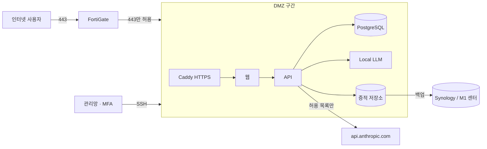

# DCP 서비스 서버 구성안 (하드웨어·소프트웨어 스택)

> 대상: DCP IDC 안에 구성할 DCP 서비스용 서버. 첫 서비스는 이 저장소의 AI 기본법 준수 플랫폼이며, 이후 AI 사용 통제 게이트웨이·증적 보관 등 다른 DCP 서비스도 같은 서버에 올리는 것을 전제로 합니다.
> 작성일: 2026-11-17 · 상태: 초안 (장비 모델 확정 후 갱신)

## 1. 설계 원칙

1. **국내 IDC 안에서 끝낸다.** 고객 자료, 증적, 로그는 DCP 센터 안에만 저장한다. 외부 AI API는 비식별화한 데이터만 보낸다.
2. **작게 시작해서 단계적으로 늘린다.** 1단계는 기존 1U 서버 1대로 시작하고, 고객이 늘면 이중화하고 AI 가속기를 추가한다.
3. **지금 데모 구성을 그대로 옮긴다.** 맥에서 검증한 Docker Compose 구성을 서버에서도 그대로 쓴다.
4. **DCP ISMS 범위에 넣는다.** 서버 전체를 ISMS 인증 범위에 포함하고, 운영망과 분리한다.

## 2. 단계별 구성 요약

| 단계 | 시점 | 서버 | AI 추론 | 비고 |
|---|---|---|---|---|
| 1단계 | 파일럿 ~ 초기 정식 서비스 | 1U 서버 1대 (기존 장비 활용) | Local LLM(CPU) + Anthropic API | 이 문서의 기준 구성 |
| 2단계 | 구독 고객 증가 | 앱 서버 2대 이중화 + 별도 스토리지 | Local LLM을 NPU/GPU 카드로 가속 | 게이트웨이와 추론 서버 공용 |
| 3단계 | 서비스 확대 | 추론 전용 서버(8카드급) | NPU/GPU 서버 | 매출 발생 후 결정 |

## 3. 하드웨어 (1단계)

| 항목 | 권장 사양 | 비고 |
|---|---|---|
| 서버 | 기존 보유 1U 서버 | 모델명 확인 후 부품 목록 확정 |
| CPU | 24~32코어 | 앱·DB는 8코어면 충분. 나머지는 CPU 추론용 |
| 메모리 | 256GB 이상, **모든 메모리 채널을 채워 장착** | CPU 추론 속도는 용량보다 채널 수(대역폭)가 결정. DDR4 세대면 리퍼 부품으로 비용 절감 가능 |
| 디스크 | NVMe 약 4TB × 2, RAID1 | NVMe 베이가 없으면 PCIe NVMe 어댑터 사용 |
| 네트워크 | 10GbE 2포트 (서비스용 / 관리용 분리) | 관리 포트는 원격 관리 카드(iDRAC, iLO 등) 연결 |
| 전원 | 이중 전원 | 1U 기준 약 300~500W |
| 증적 백업 | 기존 Synology (WriteOnce 공유 폴더) | 해당 모델의 WriteOnce 지원 여부 확인 필요 |
| 원격지 백업 | G1(강남) ↔ M1(마곡) 상호 백업 | 별도 백업 장비 없이 원격지 백업 요건 충족 |

### 메모리·디스크 개략 비용 (2026-11 기준 추정, 견적 필요)

| 구성 | DDR4 세대 서버 | DDR5 세대 서버 |
|---|---|---|
| 메모리 256GB (32GB × 8) | 리퍼 약 180~270만원 / 신품 약 450만원 | 약 600~1,500만원 |
| NVMe 약 4TB × 2 | 약 120~180만원 | 약 120~180만원 |
| 합계 | 약 300~450만원 | 약 700~1,700만원 |

2025년 말부터 서버 메모리 가격이 급등했으므로 반드시 유통사 견적으로 확정한다.

### DCP 쪽 준비 사항

- [ ] 랙 1U, 전원 2구
- [ ] 네트워크 포트 2개 (서비스 DMZ, 관리망)
- [ ] 공인 IP 1개
- [ ] 서비스 도메인 1개 (예: `aiact.<회사도메인>`) 및 DNS 레코드
- [ ] 장비 모델명, CPU, 현재 메모리 구성, 드라이브 베이 종류, 보증 기간 확인

## 4. 소프트웨어 스택

| 계층 | 선택 | 이유 |
|---|---|---|
| OS | Ubuntu Server 24.04 LTS | 장기 지원, Docker 공식 지원 |
| 디스크 암호화 | LUKS (전체 디스크) | 장비 반출·폐기 시 데이터 보호 |
| 실행 환경 | Docker Engine + Docker Compose | 데모 구성을 그대로 이전 |
| 웹 입구 | Caddy (HTTPS 인증서 자동 발급·갱신) | Nginx로 대체 가능 |
| 애플리케이션 | 웹: Next.js / API: FastAPI | 이 저장소 그대로 |
| 데이터베이스 | PostgreSQL 16 | 매일 백업, 시점 복구용 WAL 보관 |
| 증적 저장소 | S3 호환 객체 스토리지 (Object Lock) | 5년 변경 불가 보관. 초기에는 Synology WriteOnce로 대체 가능. MinIO 사용 시 최신 라이선스·배포 정책 확인 |
| 백업 | restic (암호화 백업) → M1 센터 | 매일 백업, 월 1회 복구 훈련 |
| 모니터링 | Prometheus, Grafana, Loki | DCP 운영팀이 쓰는 도구와 통일 |
| 인증 | 앱 자체 로그인 → 정식 서비스 시 Keycloak (SSO, MFA) | 고객·로펌 외부 사용자 관리 |
| 배포 | GitHub(DCP-Dev-7/ai-act-compliance) → 서버 갱신 | 이후 GitHub Actions 자체 호스팅 러너로 자동 배포 |

## 5. AI 추론 구성: Local LLM + Anthropic API

### 5.1 역할 분담

| 작업 | 처리 위치 | 이유 |
|---|---|---|
| 법 적용 판정 | 규칙 엔진 (LLM 아님) | 조문을 코드로 옮긴 결정 트리. 설명 가능·재현 가능 |
| 고객 문서에서 사실 추출 | **Local LLM** | 고객 원문을 직접 읽는 단계이므로 국내 처리. 추출 결과는 원문과 대조해 검증 |
| 문서 초안 작성 (고지 문구, 약관 조항 등) | **Anthropic API** (비식별화한 요약만 전송) | 한국어 법률 문장 품질 확보 |
| "외부 반출 금지" 고객 | **전부 Local LLM** | 고객별 설정으로 강제 (이미 구현됨) |

### 5.2 Local LLM

| 항목 | 내용 |
|---|---|
| 추론 서버 | llama.cpp `llama-server` (OpenAI 호환 API 제공) |
| 모델 후보 | 상업 이용 가능한(Apache 2.0) MoE 모델: gpt-oss-120b(4비트 약 65GB), Qwen3-30B-A3B 등. 도입 시점의 최신 버전과 라이선스를 다시 확인 |
| 주의 | 국산 모델은 한국어에 강하지만 상업 이용이 제한되는 라이선스가 있음(예: LG EXAONE). 사용 전 라이선스 확인 필수 |
| 예상 속도 (CPU, 추정) | 생성 초당 15~30토큰, 10쪽 문서 읽기 1~3분. 실시간 대화가 아닌 일괄 처리에 적합. 서버 도입 후 실측 |
| 앱 연결 | `.env`에서 `LLM_PROVIDER=openai_compatible`, `INTERNAL_LLM_BASE_URL`, `INTERNAL_LLM_MODEL` 설정 (README 9장) |
| 품질 관리 | 골든셋 회귀 시험으로 모델 변경 시 품질 확인. 기준 미달 시 승격 차단 |
| 2단계 가속 | NPU 카드(예: FuriosaAI RNGD — Qwen 계열 공식 지원) 또는 GPU 카드 추가 |

> 현재 코드는 고객 단위로 모델을 고릅니다. 5.1의 "작업별 분담"(추출은 내부, 초안은 외부)은 라우터에 작업별 설정을 추가해야 합니다. (후속 작업)

### 5.3 Anthropic API (외부)

| 항목 | 설정 |
|---|---|
| 조직 | **DCP 명의 조직**으로 신설, 회사 카드 결제 (개인 조직 사용 중단) |
| 워크스페이스 | 서비스 전용 워크스페이스 (예: `ai-act-platform`) |
| 지출 한도 | 워크스페이스별 월 지출 한도 설정 → 서비스 비용만 분리 집계·차단 |
| 키 | 개인 키가 아닌 **서비스 계정 키** 사용 (담당자 변경과 무관하게 유지) |
| 보관 | 서버의 `.env`에만 저장, 저장소에 커밋 금지 (`.gitignore` 적용됨) |
| 모델 | `claude-fable-5-2` (환경 변수로 변경 가능) |

### 5.4 외부 AI로 젠스파크를 쓰지 않는 이유 (검토 결과)

- 공식 API가 검색·크롤링·이미지 생성 등 젠스파크 기능 호출용이며, 일반 LLM 호출 API(OpenAI 호환) 제공 여부가 확인되지 않음
- 고객 데이터가 젠스파크(기본 처리 지역 미국 서부)를 거쳐 다시 모델사로 전달되는 이중 경로
- 기업 고객 보안 정책 문서상 SOC 2 Type II, ISO 27001이 진행 중으로 표기
- API 전용 요금 없이 플랜 크레딧에서 차감되어 직원 사용분과 비용이 섞임
- 결론: 직원 업무용 도구로는 유지하되, 고객 자료를 처리하는 서비스 엔진으로는 사용하지 않음. 회사 방침상 통일이 필요하면 OpenAI 호환 API 제공, 모델 지정, 처리 지역, 별도 정산, 위탁 계약·인증 일정을 먼저 확인

## 6. 네트워크·보안

| 항목 | 설정 |
|---|---|
| 망 분리 | DCP 운영망과 분리된 DMZ VLAN에 배치 (모의심사의 운영망 분리 지적 반영) |
| 인바운드 | 443(HTTPS)만 허용 |
| 아웃바운드 | 허용 목록만: `api.anthropic.com`, OS·패키지 저장소, GitHub |
| 관리 접속 | 관리망에서만 SSH, 키 인증 + MFA, 접속 기록 보관 |
| 원격 관리 카드 | 관리망에만 연결, 기본 계정·비밀번호 변경 |
| 패치 | 보안 업데이트 자동 적용, 컨테이너 이미지 월 1회 갱신 |
| 비밀 관리 | API 키·DB 비밀번호는 `.env`(권한 600) 또는 비밀 관리 도구, 저장소 커밋 금지 |
| 로그 | 앱 감사 로그 + 접속 로그를 Loki로 수집, 1년 이상 보관 |
| 회선 | KT 단일 회선은 1단계에서 감수, 정식 서비스 단계에서 가용성 리스크로 재검토 |

## 7. 운영

| 업무 | 주기 | 방법 |
|---|---|---|
| 증적 체인 검증 | 매일 | 앱 스케줄러 (이미 구현됨) |
| DB·증적 백업 | 매일 | restic → M1 센터 |
| 복구 훈련 | 월 1회 | 백업으로 임시 환경 복구 후 검증 |
| 골든셋 회귀 시험 | 매일 / 모델 변경 시 | 앱 스케줄러 (이미 구현됨) |
| 보안 업데이트 | 자동 + 월 1회 점검 | unattended-upgrades, 이미지 갱신 |
| 비용 점검 | 월 1회 | Anthropic 워크스페이스 사용량, 운영 콘솔 토큰 집계 |

## 8. 서버 도입 후 할 일 (체크리스트)

- [ ] 장비 모델 확인 → 메모리·디스크 구매 목록 확정
- [ ] OS 설치, 디스크 암호화, DMZ 배치, 방화벽 규칙 적용
- [ ] Docker 설치 후 이 저장소 배포, Caddy로 HTTPS 적용
- [ ] llama.cpp 설치, 후보 모델 2종 실측 (속도·골든셋 일치율)
- [ ] Anthropic DCP 조직·워크스페이스·서비스 계정 키·지출 한도 설정
- [ ] 백업·모니터링 설정, 첫 복구 훈련
- [ ] DCP ISMS 범위에 서버 추가, 운영명세서 갱신

## 9. 출처

- [Render — 무료 플랜 제약](https://render.com/docs/free) (클라우드 임시 배포 검토 시 참고)
- [Capital and Compute — Server RAM Prices 2026](https://capitalandcompute.net/memory-prices/server/)
- [PCSP — Refurbished DDR4 Server Memory 2026](https://pcserverandparts.com/news/refurbished-ddr4-server-memory-2026-server-ram-price-crisis/)
- [ALO Info — Enterprise SSD Price Guide 2026](https://www.aloinfousa.com/pages/enterprise-ssd-price-guide-2026)
- [FuriosaAI — RNGD Server](https://furiosa.ai/rngd-server)
- [Claude Platform Docs — API 키](https://platform.claude.com/docs/ko/get-api-key)
- [Genspark — Enterprise Clients Data Security & Privacy Policy](https://genspark.ai/policies/enterprise-clients-data-security-and-privacy-policy)
- [WEEL — Genspark API (2026.9)](https://weel.co.jp/media/innovator/genspark-api/)
