# 사용 가이드: 화면마다 무엇을 보고, 어떻게 설명하나

> 대상: 데모를 시연하거나 경영진·고객에게 설명하는 사람
> 각 화면이 무엇인지, 어떤 버튼을 누르는지, 결과를 어떻게 읽는지를 정리했습니다. 캡처는 가상 고객 "A사"와 연습 시나리오(B~E사, 전부 가상)로 실제 데모를 돌린 화면입니다. **가상 데이터 · 법률 자문 아님.**
> 1~13번 캡처는 이전 버전에서 찍은 것이라 상단 메뉴의 `AI 기본법 한눈에`와 고객사 현황의 `고객사 등록` 버튼이 보이지 않습니다. 14번부터가 현재 화면입니다.
> 이 가이드는 앱 안에서도 볼 수 있습니다. 로그인한 뒤 상단 메뉴의 **`사용 가이드`** 를 누르면 같은 내용이 열립니다(21번까지의 캡처에는 이 메뉴가 생기기 전이라 보이지 않습니다).

## 목차

- 시작: [이 플랫폼이 하는 일](#이-플랫폼이-하는-일) · [전체 흐름 8단계](#전체-흐름-8단계) · [용어 풀이](#용어-풀이) · [계정과 권한](#계정과-권한)
- 화면별 설명: [공통](#공통-상단-배너와-메뉴) · [고객사 현황](#1-고객사-현황) · [개요·자료](#2-개요자료-단계-1) · [AI 인벤토리](#3-ai-인벤토리-단계-2) · [판정](#4-판정-단계-34) · [갭 리포트](#5-갭-리포트-단계-5) · [문서 초안](#6-문서-초안-단계-67) · [증적함](#7-증적함-단계-8) · [기술 점검](#8-기술-점검-구독-서비스) · [변경·재평가](#9-변경재평가-구독-서비스) · [법령 지식베이스](#10-법령-지식베이스) · [운영 콘솔](#11-운영-콘솔)
- 직접 해 보며 법 익히기: [고객사 등록](#12-고객사-등록) · [연습 시나리오로 법 이해하기](#13-연습-시나리오로-법-이해하기) · [AI 기본법 한눈에와 화면 속 설명](#14-ai-기본법-한눈에와-화면-속-설명)
- 경영진 보고: [10분 시연 순서](#10분-시연-순서) · [예상 질문과 답](#예상-질문과-답)

---

## 이 플랫폼이 하는 일

**고객사가 AI 기본법을 지키고 있는지 진단하고, 부족한 부분을 고칠 문서를 만들어 주고, 그 기록을 5년간 안전하게 보관하는 시스템입니다.**

컨설턴트가 며칠씩 걸려 하던 일(고객 자료 읽기, 법 조문 대조, 보고서·문서 초안 작성, 증거 보관, 법 개정 추적)을 시스템이 대신하고, 컨설턴트는 "이 판단이 맞는가"만 확인합니다.

비유하면 **회계 감사 소프트웨어**와 비슷합니다. 장부(고객 자료)를 넣으면 규정(AI 기본법)과 맞춰 보고, 문제(갭)를 찾고, 고칠 방법(문서 초안)을 내고, 감사 조서(증적)를 남깁니다.

## 전체 흐름 8단계

화면 상단의 초록 막대 8칸이 이 순서입니다. 채워진 칸까지 끝난 것입니다. 앞 단계를 다시 실행하면 그 뒤 단계는 다시 해야 합니다.

| 단계 | 이름 | 하는 일 |
|---|---|---|
| 1 | 자료 접수 | 고객 설문·소개서·약관·개발 문서를 받음 |
| 2 | 인벤토리 | 자료에서 "어떤 AI를 쓰는지" 목록을 뽑음 |
| 3 | 판정 초안 | AI마다 법의 어떤 의무가 걸리는지 시스템이 판단 |
| 4 | 판정 확정 | 컨설턴트가 근거를 보고 승인 |
| 5 | 갭 리포트 | 해야 할 것과 지금 하고 있는 것을 비교 |
| 6 | 문서 초안 | 고칠 문구·약관 조항을 자동 작성 |
| 7 | 승인 | 컨설턴트가 문서를 승인 |
| 8 | 증적 보관 | 모든 결과를 위변조 불가 방식으로 5년 보관 |

8단계가 끝난 뒤에도 **기술 점검**(고객 서비스를 주기적으로 검사)과 **변경·재평가**(법이 바뀌면 다시 판정)가 구독 서비스로 계속 돌아갑니다.

## 용어 풀이

| 화면에 나오는 말 | 쉬운 뜻 |
|---|---|
| 개발사업자 / 이용사업자 | AI를 직접 만들어 파는 회사 / 남이 만든 AI(예: Claude, GPT API)를 가져다 자기 서비스에 붙인 회사. A사는 외부 API를 쓰므로 이용사업자 |
| 생성형 AI | 글·이미지·소리·영상을 새로 만들어 내는 AI |
| 고영향 AI | 의료·채용·대출·교육 평가처럼 사람의 생명이나 권리에 큰 영향을 주는 분야의 AI. 의무가 훨씬 무거움 |
| 제31조 사전 고지 | "이 서비스는 AI로 돌아갑니다"라고 이용자에게 미리 알려야 하는 의무. 어기면 과태료 3천만원 이하 |
| 제31조 생성물 표시 | AI가 만든 결과물에 "AI 생성"이라고 표시하는 의무. 눈에 보이는 표시나 파일 속 정보(메타데이터)로 |
| 내부 업무용 예외 | 직원만 쓰고 고객에게 보이지 않는 AI는 고지·표시 의무가 없음 |
| 갭(GAP) | 법이 요구하는 것과 고객이 실제로 하고 있는 것의 차이 = 고쳐야 할 항목 |
| 근거 / 인용 | 판단의 이유. 법 조문(회색 태그)과 고객 자료의 원문 문장(노란 박스)을 함께 보여줌 |
| 근거 미확인 | 시스템이 쓴 문장 중 법 조문과 연결되지 않은 것. 사람이 꼭 확인하라는 경고 |
| 증적 | "우리가 이렇게 판단하고 이렇게 조치했다"는 증거 기록. 법은 고영향 AI 관련 문서를 5년 보관하도록 함 |
| 해시 / 체인 | 파일의 지문(SHA-256). 앞 기록의 지문을 다음 기록에 엮어 두어, 누가 하나라도 고치면 바로 드러나는 구조 |
| KB(지식베이스) | 시스템이 참고하는 법 조문 요약집. 버전이 있음(예: 2026.01-v1) |
| 재평가 | 법이나 고객 서비스가 바뀌어 기존 판정을 다시 봐야 하는 작업 |
| LLM 모드: mock / anthropic | mock = 정해진 규칙·템플릿으로 답함(무료). anthropic = Claude Fable 5.2가 실제로 자료를 읽고 문서를 씀(유료) |
| 골든셋 | 정답을 미리 알고 있는 시험 문제 33개. 시스템을 바꿀 때마다 풀려서 실력이 떨어지지 않았는지 확인 |

## 계정과 권한

| 계정 | 누구 | 할 수 있는 것 |
|---|---|---|
| `a-company@demo` | 고객사 담당자 | 자료 올리기, 결과 보기. **판정 확정·문서 승인은 못 함** |
| `consultant@demo` | DCP 컨설턴트 | 모든 진행 단계 실행, 판정 확정, 문서 승인 |
| `ops@demo` | DCP 운영자 | 운영 콘솔의 자동화 작업 실행, 비용·품질 확인 |

비밀번호는 모두 `demo1234`. 시연은 `consultant@demo`로 하면 됩니다.

고객사 등록은 컨설턴트와 운영자만 할 수 있습니다. 등록할 때 그 고객사의 **고객 담당자 계정**(이메일·비밀번호를 컨설턴트가 정함)을 함께 만들 수 있고, 그 계정은 자기 고객사 화면만 봅니다. → [12. 고객사 등록](#12-고객사-등록)

---

## 공통: 상단 배너와 메뉴

| 위치 | 뜻 |
|---|---|
| 노란 배너 | "가상 데이터·법률 자문 아님" 경고, 현재 LLM 모드(mock 또는 anthropic·claude-fable-5-2), 사용 중인 법령 KB 버전 |
| 고객사 | 고객별 진행 현황과 작업 화면. `고객사 등록` 버튼이 여기 있음 |
| AI 기본법 한눈에 | 법을 처음 보는 사람을 위한 5분 설명(결정 흐름, 시나리오 A~E 비교) |
| 사용 가이드 | 지금 보고 있는 이 가이드. 모든 계정에서 보이며, 왼쪽 목차로 화면별 설명에 바로 갈 수 있음 |
| 법령 지식베이스 | 시스템이 참고하는 법 조문 요약과 출처 |
| 운영 콘솔 | 자동화 작업, AI 품질 점검, 비용 |
| 고객사 화면의 탭 | 개요·자료 / AI 인벤토리 / 판정 / 갭 리포트 / 문서 초안 / 증적함 / 기술 점검 / 변경·재평가. 진행 단계와 같은 순서 |

---

## 1. 고객사 현황

`메뉴: 고객사`

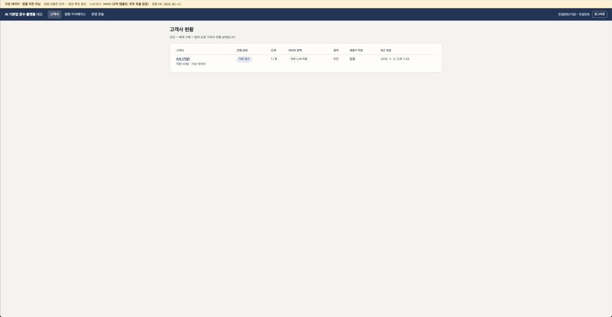

| | |
|---|---|
| **무엇인가** | DCP가 맡은 고객사 목록과 각자 어디까지 진행됐는지 한눈에 보는 화면 |
| **어떻게 쓰나** | 고객사 이름(**A사 (가상)**)을 눌러 들어갑니다 |
| **결과 읽는 법** | **진행 상태·단계**: 8단계 중 어디인지(1/8 = 자료 접수 중) · **데이터 정책**: 고객 자료를 외부 AI에 보내도 되는지 · **증적**: 보관된 기록 수 · **재평가 작업**: 다시 봐야 할 건수 |

## 2. 개요·자료 (단계 1)

`고객사 → 탭: 개요·자료`

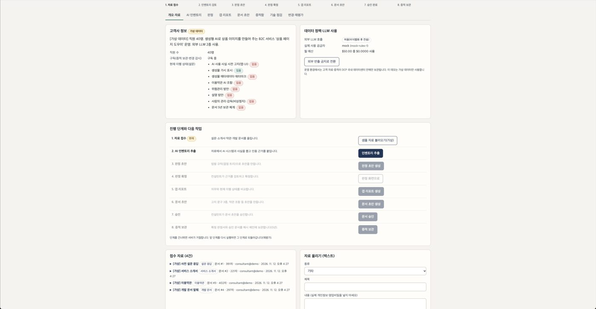

| | |
|---|---|
| **무엇인가** | 고객 기본 정보, 고객이 설문으로 답한 현재 이행 상태, 데이터 정책, 그리고 8단계 버튼이 모인 출발 화면 |
| **어떻게 쓰나** | ① `샘플 자료 불러오기(가상)` → 가상 자료 4건이 들어옴 ② 오른쪽 버튼을 위에서부터 차례로 누르면 단계가 진행됨 ③ 실제 고객이라면 아래 "자료 올리기"에 문서를 넣음 |
| **결과 읽는 법** | **현재 이행 상태(설문)**: 빨간 "아니오" = 고객이 아직 안 하고 있는 것. A사는 생성물 가시 표시만 "예"(이전 캡처에는 "있음/없음"으로 보입니다). 고영향 AI에만 해당하는 4항목(제34조)은 안쪽 상자로 따로 묶여 있습니다 · **외부 LLM 호출**: "허용(비식별화 후 전송)" = 이름·연락처 등을 가린 뒤 AI에 보냄 · **월 예산**: 이 고객에게 쓸 AI 비용 한도와 사용액 |
| **주의** | `외부 반출 금지로 전환`을 누르면 이 고객 자료는 외부 AI로 절대 나가지 않고 내부 모델이나 규칙으로만 처리됩니다 |

## 3. AI 인벤토리 (단계 2)

`탭: AI 인벤토리 · 버튼: 인벤토리 추출`

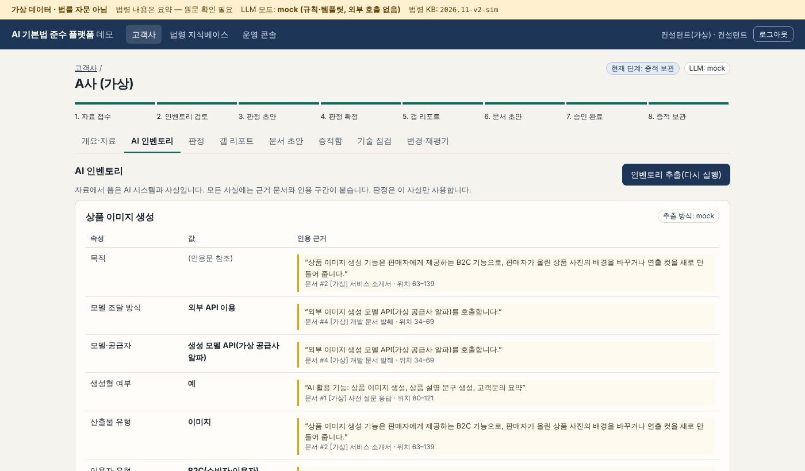

| | |
|---|---|
| **무엇인가** | 고객 자료를 읽고 "이 회사가 어떤 AI를, 어떻게, 누구에게 쓰는지"를 정리한 목록. A사는 상품 이미지 생성, 상품 설명 문구 생성, 고객문의 요약 3개 |
| **어떻게 쓰나** | `인벤토리 추출`을 누르고 이 탭에서 확인합니다. 고객에게 "빠진 AI가 없는지" 확인받는 단계입니다 |
| **결과 읽는 법** | **속성·값**: 목적, 외부 API 사용 여부, 생성형 여부, 산출물 종류, 이용자(고객용/내부용) · **인용 근거(노란 박스)**: 그 값을 어느 문서에서 찾았는지. 근거 없는 사실은 쓰지 않음 · **추출 방식**: mock이면 규칙, anthropic이면 Claude가 읽음 |
| **주의** | 다음 단계인 판정은 오직 여기 사실만 씁니다. 여기가 틀리면 판정도 틀리므로 실제 업무에서는 고객 확인이 중요합니다 |

## 4. 판정 (단계 3·4)

`탭: 판정 · 버튼: 판정 초안 생성, 이 판정 확정`

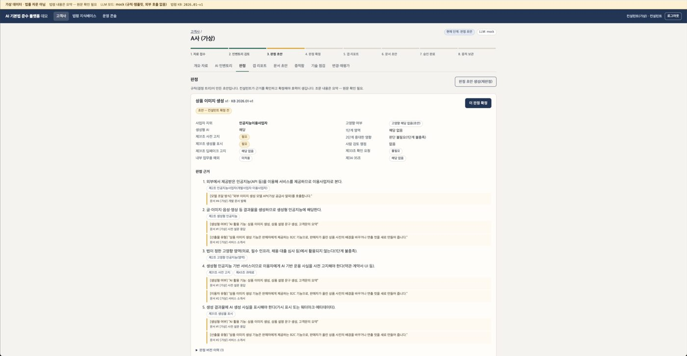

| | |
|---|---|
| **무엇인가** | AI 하나하나에 대해 "법의 어떤 의무가 걸리는가"를 내린 판단서. **판단은 AI가 아니라 법 조문을 코드로 옮긴 규칙**이 합니다 |
| **어떻게 쓰나** | ① 개요 화면에서 `판정 초안 생성` ② 이 탭에서 근거를 읽고 AI마다 `이 판정 확정` ③ 확정해야 다음 단계(갭 리포트)가 열림 |
| **결과 읽는 법** | **왼쪽 칸**: 사업자 지위, 생성형 여부, 제31조 의무 3가지(필요/해당 없음), 내부 업무용 예외 · **오른쪽 칸**: 고영향 여부와 그 판단 2단계(영역 → 중대한 영향) · **판정 근거**: 번호마다 법 조문(회색 태그) + 고객 원문(노란 박스) |
| **A사 결과** | 이미지·문구 생성은 고객에게 제공되므로 사전 고지와 생성물 표시 **필요**. 고객문의 요약은 직원만 쓰므로 **예외 적용**. 세 개 모두 고영향 아님 |

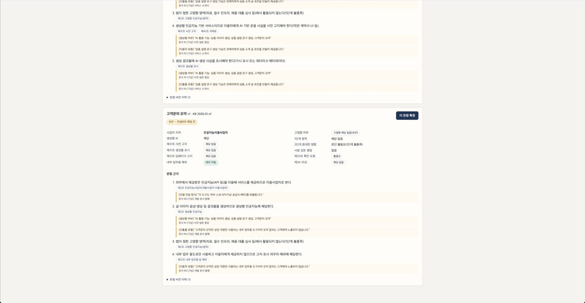

고객문의 요약은 "내부 업무용 예외 — 예외 적용"으로 판정되어 고지·표시 의무가 모두 "해당 없음"입니다.

## 5. 갭 리포트 (단계 5)

`탭: 갭 리포트 · 버튼: 갭 리포트 생성`

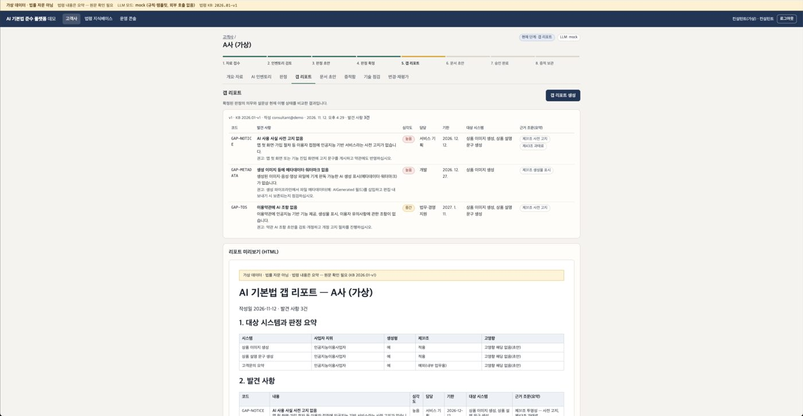

| | |
|---|---|
| **무엇인가** | 확정된 판정에서 나온 "해야 할 일"과 고객의 "지금 상태"를 비교해 **고쳐야 할 목록**을 만든 보고서. 고객에게 보내는 진단 결과물 |
| **어떻게 쓰나** | `갭 리포트 생성`을 누르면 표와 함께 아래에 고객 제출용 HTML 보고서가 만들어집니다 |
| **결과 읽는 법** | **코드**: GAP-NOTICE(사전 고지 없음), GAP-METADATA(이미지 메타데이터 없음), GAP-TOS(약관 AI 조항 없음) · **심각도**: 높음 = 과태료나 직접 의무 위반 위험 · **담당·기한**: 고객사 안에서 누가 언제까지 고칠지 제안 · **근거 조문**: 왜 고쳐야 하는지 |
| **상품 연결** | 여기까지가 **진단 상품**의 결과물 |

## 6. 문서 초안 (단계 6·7)

`탭: 문서 초안 · 버튼: 문서 초안 생성, 문서 승인`

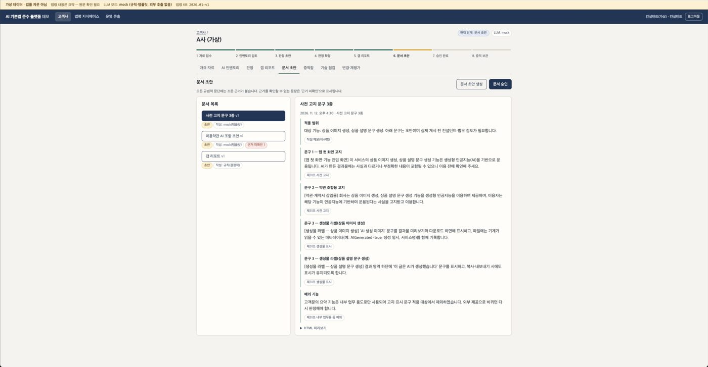

| | |
|---|---|
| **무엇인가** | 갭을 고치는 데 필요한 실제 문서를 자동으로 쓴 초안. 앱 첫 화면 고지 문구, 약관 삽입 문구, 생성물 라벨 문구, 약관 AI 조항, 갭 리포트 |
| **어떻게 쓰나** | ① `문서 초안 생성` ② 왼쪽 목록에서 문서를 골라 오른쪽에서 읽음 ③ 확인이 끝나면 `문서 승인` → 확인창에서 확인 |
| **결과 읽는 법** | 문단마다 근거 조문 태그가 붙음 · **근거 미확인 1**: 조문과 연결되지 않은 문장이 1개 있음 → 사람이 꼭 검토 · **작성: mock(템플릿)** 또는 anthropic: 누가 썼는지 |
| **상품 연결** | 이 문서들이 **투명성 패키지**의 결과물. 고객 개발팀이 그대로 화면과 약관에 반영 |

## 7. 증적함 (단계 8)

`탭: 증적함 · 버튼: 증적 보관(승인본), 체인 검증`

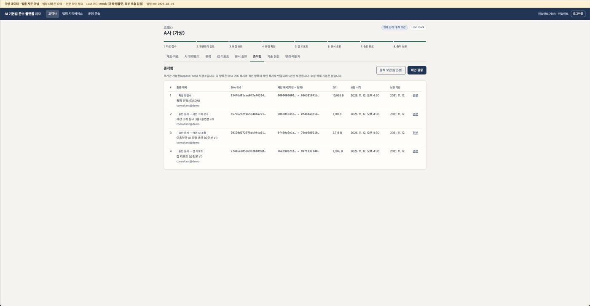

| | |
|---|---|
| **무엇인가** | 확정된 판정서와 승인된 문서를 **고칠 수도 지울 수도 없게** 보관하는 금고. 보관 기한 5년 |
| **어떻게 쓰나** | ① `증적 보관(승인본)`: 승인된 결과를 금고에 넣음 ② `체인 검증`: 금고 안 기록이 하나도 바뀌지 않았는지 검사 ③ **원본**: 보관된 파일 열람 |
| **결과 읽는 법** | **SHA-256**: 파일의 지문 · **체인 해시(직전 → 현재)**: 앞 기록과 사슬처럼 엮인 값. 1번은 0000…에서 시작 · 체인 검증 "정상" = 위변조 없음 |
| **상품 연결** | **증적 보관 구독**의 핵심. 운영 환경에서는 DCP 국내 센터 안에 보관 |

## 8. 기술 점검 (구독 서비스)

`탭: 기술 점검 · 버튼: 지금 점검`

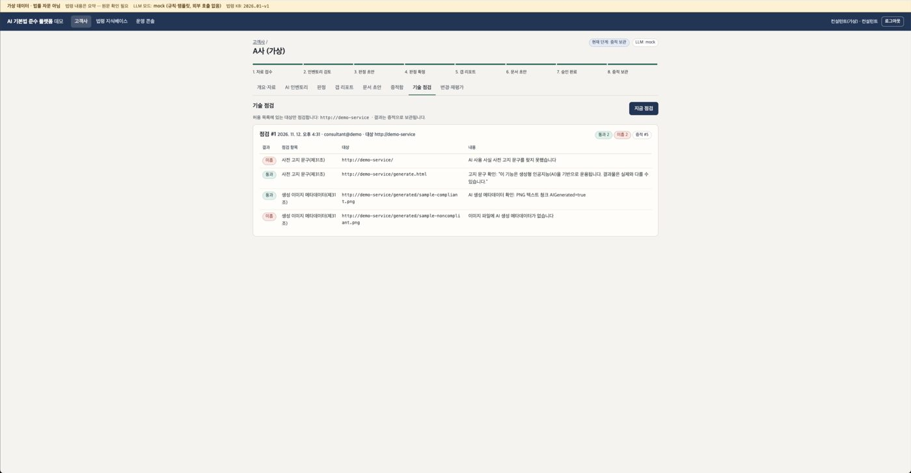

| | |
|---|---|
| **무엇인가** | 고객의 실제 서비스 화면과 AI가 만든 파일을 시스템이 직접 들어가 보고, 고지 문구와 AI 생성 표시가 제대로 있는지 검사 |
| **어떻게 쓰나** | `지금 점검`. 평소에는 매주 자동으로 돕니다. 허락받은 주소(허용 목록)만 점검합니다 |
| **결과 읽는 법** | **통과 2 / 미흡 2** · 미흡: 메인 화면(/)에 AI 고지 문구 없음 · 통과: 생성 화면(generate.html)에는 고지 있음 · 통과: 이미지 1개에 AIGenerated=true 표시 있음 · 미흡: 다른 이미지에는 없음 · 결과는 증적으로 자동 보관 |
| **의미** | 문서만 고친 게 아니라 **실제 서비스에 반영됐는지**를 계속 확인. 데모의 A사 사이트는 가상으로 만든 것 |

## 9. 변경·재평가 (구독 서비스)

`탭: 변경·재평가 · 버튼: 법령 변경 반영(시뮬레이션), 완료 처리`

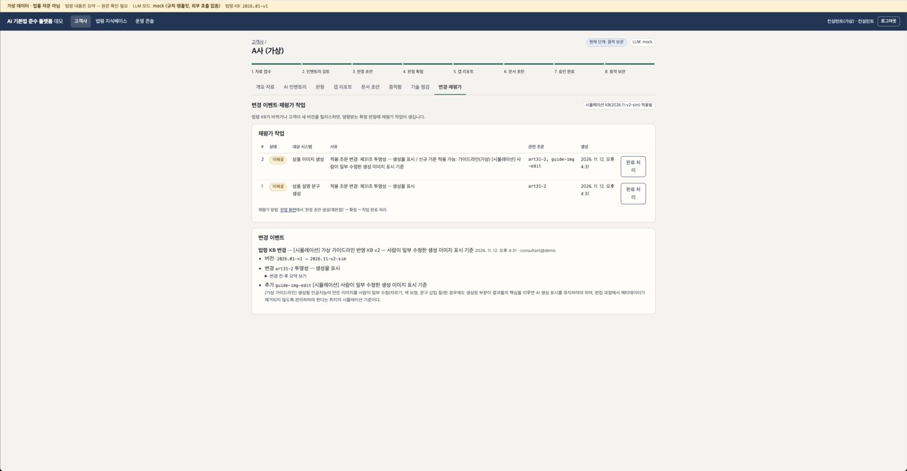

| | |
|---|---|
| **무엇인가** | 법이나 가이드라인이 바뀌면, 영향을 받는 고객 판정을 찾아 "다시 봐야 함" 작업을 자동으로 만드는 화면 |
| **어떻게 쓰나** | ① `법령 변경 반영(시뮬레이션)`: "사람이 일부 수정한 AI 이미지도 표시해야 한다"는 **가상** 가이드라인을 적용 ② 재평가 작업 2건이 생김 ③ 판정 탭에서 `판정 초안 생성(재판정)` → 확정 ④ 여기로 돌아와 `완료 처리` |
| **결과 읽는 법** | **재평가 작업**: 미해결/완료, 대상 AI, 사유, 관련 조문 · **변경 이벤트**: 법 버전이 2026.01-v1 → 2026.11-v2-sim으로 바뀐 내용과 무엇이 추가됐는지 · 고객문의 요약(내부용)은 영향이 없으므로 작업이 생기지 않음 |
| **상품 연결** | 구독 고객에게 "법이 바뀌면 저희가 먼저 알려드립니다"를 제공하는 기능 |

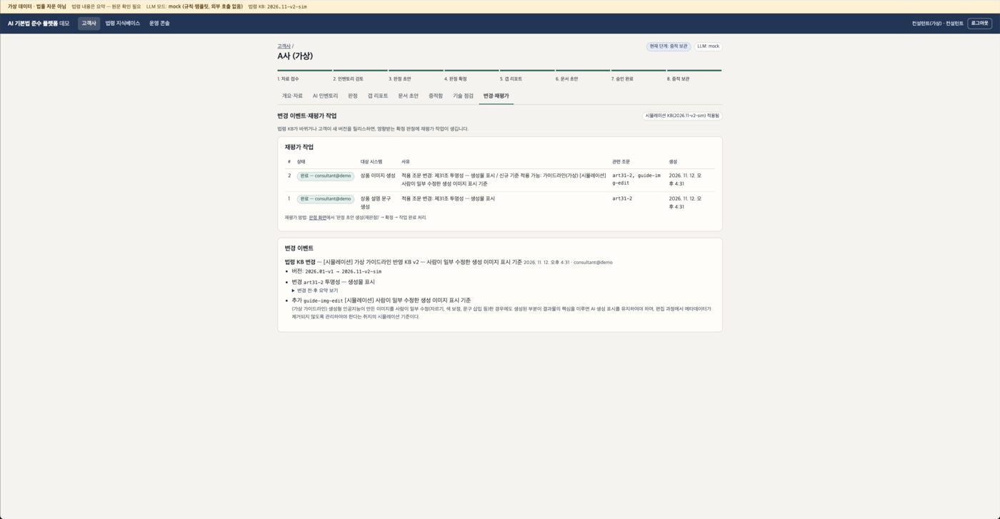

재판정과 완료 처리까지 끝나면 두 작업 모두 "완료 — consultant@demo"로 바뀝니다. 누가 처리했는지도 기록됩니다.

## 10. 법령 지식베이스

`메뉴: 법령 지식베이스`

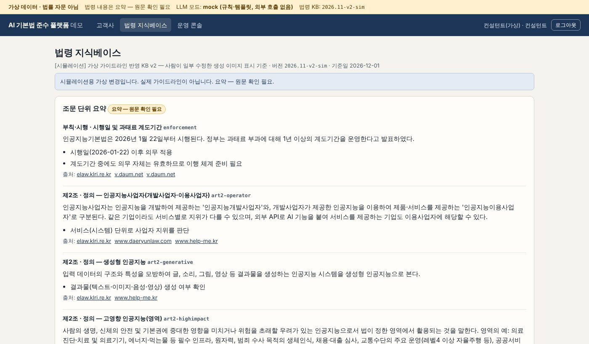

| | |
|---|---|
| **무엇인가** | 시스템이 판정할 때 참고하는 AI 기본법 조문 요약집. 조문마다 출처 링크가 있음 |
| **어떻게 쓰나** | 읽기 전용. 판정 근거의 회색 조문 태그가 여기 항목을 가리킴 |
| **결과 읽는 법** | **버전·기준일**: 지금 어느 법령 기준으로 판정하는지 · **요약 — 원문 확인 필요**: 원문이 아니라 요약이라는 표시 |

## 11. 운영 콘솔

`메뉴: 운영 콘솔 (ops@demo 권장)`

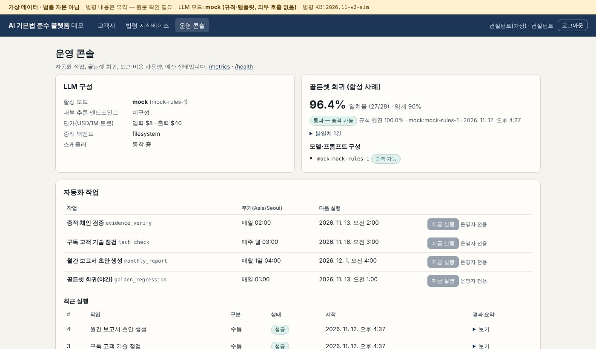

| | |
|---|---|
| **무엇인가** | 사람 손 없이 돌아가는 자동화 작업, AI 품질 점검, 비용을 관리하는 화면 |
| **어떻게 쓰나** | 평소에는 보기만 합니다. 시연 때는 `ops@demo`로 들어가 `지금 실행`을 누르면 예약된 작업을 즉시 돌릴 수 있습니다 |
| **결과 읽는 법** | **LLM 구성**: 지금 쓰는 AI와 단가(입력 $8 / 출력 $40, 100만 토큰당) · **골든셋 회귀**: 정답 아는 시험 33문제 중 맞힌 비율. 90% 아래면 새 설정을 "승격 차단" · **자동화 작업 4개**: 매일 증적 검증, 매주 기술 점검, 매월 보고서 초안, 매일 골든셋 시험 · **고객별 예산·토큰 사용량**: AI 비용 |
| **주의** | 골든셋 96.4%는 시스템이 스스로 만든 시험 기준이라, 실제 고객 문서에서의 정확도가 아닙니다. "품질이 떨어지지 않았는지 보는 경보"로 설명 |

## 12. 고객사 등록

`메뉴: 고객사 → 버튼: 고객사 등록` (컨설턴트·운영자만. 고객 담당자에게는 버튼이 보이지 않고 서버도 거절합니다)

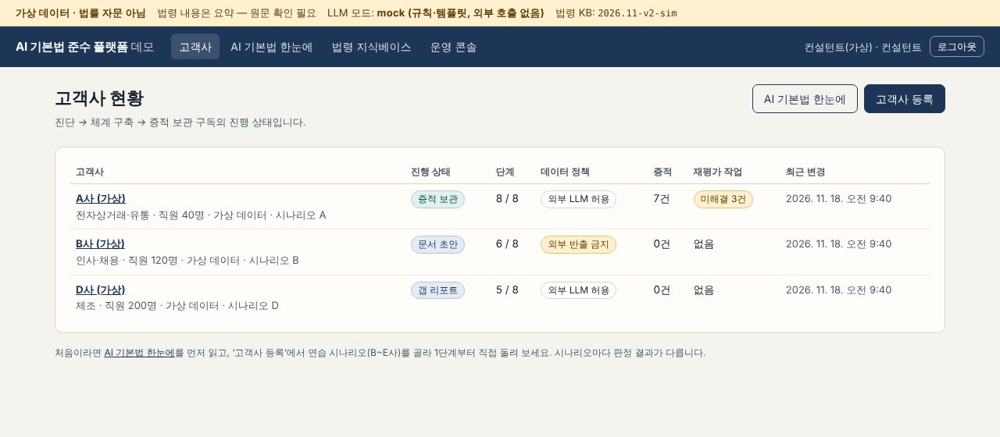

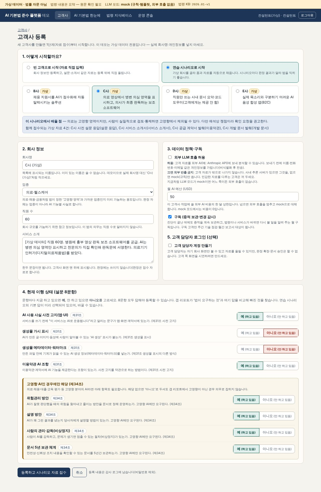

| | |
|---|---|
| **무엇인가** | 새 고객사를 만드는 화면. 등록하면 1단계(자료 접수)부터 A사와 똑같은 8단계를 처음부터 밟습니다 |
| **어떻게 쓰나** | ① 시작 방식을 고릅니다: **빈 고객으로 시작**(회사 정보만 넣고 자료는 나중에 직접 올림) 또는 **연습 시나리오로 시작**(B~E사 중 하나를 고르면 폼과 가상 자료가 자동으로 채워짐) ② 회사 정보·데이터 정책·설문 8문항을 확인하거나 고칩니다 ③ `고객사 등록`(시나리오면 `등록하고 시나리오 자료 접수`) |
| **항목 읽는 법** | 모든 항목 아래에 한 줄 설명이 있습니다. 헷갈리기 쉬운 것만 추리면: **외부 LLM 호출 허용** = 켜면 개인정보를 가린 뒤 외부 AI로 보낼 수 있고, 끄면 자료가 밖으로 나가지 않음(외부 반출 금지) · **월 AI 예산** = 외부 AI 비용 상한, 넘으면 mock으로 대체 · **구독** = 진단 후에도 증적 보관과 변경 감시를 계속 받는지 · **현재 이행 상태 8문항** = 문항마다 **예(하고 있음) / 아니오(안 하고 있음)** 중 하나를 고릅니다. 빈 고객은 아무것도 선택되어 있지 않고, 8문항을 모두 답해야 등록됩니다(안 고른 문항 옆에 "예 또는 아니오를 선택하세요"가 뜹니다). 연습 시나리오를 고르면 그 시나리오의 기본 답이 미리 선택되며 바꿀 수 있습니다. 위 4문항은 제31조(고지·표시), 아래 안쪽 상자 **"고영향 AI인 경우에만 해당 (제34조)"** 의 4문항은 고영향 AI에만 요구되는 것입니다 — 판정에서 고영향 후보가 나오지 않으면 여기를 "아니오"로 두어도 갭으로 잡히지 않습니다. 갭 리포트가 이 답과 법의 요구를 비교합니다. 문항마다 관련 조문(제31조 / 제34조) 태그가 붙어 있고 누르면 조문 요약이 열립니다 |
| **고객 담당자 로그인(선택)** | 이메일과 비밀번호(8자 이상)를 정하면 그 고객사 전용 계정이 생깁니다. 로그아웃 후 그 계정으로 들어가면 고객 쪽 화면을 시연할 수 있습니다: 자기 회사만 보이고, 자료는 올릴 수 있지만 확정·승인 버튼은 비활성화됩니다. 비밀번호는 해시로만 저장되어 다시 볼 수 없습니다 |
| **주의** | 같은 회사명은 다시 쓸 수 없습니다(시나리오를 두 번 고르면 "B사 2 (가상)"처럼 이름을 바꿔 제안). 데모는 가상 데이터 전용이라 실제 회사명·개인정보를 넣지 마세요. 등록 사실은 감사 로그(`customer.create`)에 남습니다 |
| **빈 고객으로 등록했다면** | 개요 화면의 `자료 올리기`에서 직접 입력합니다. `작성 예시 넣기`를 누르면 형식을 볼 수 있습니다. mock 모드는 키워드 규칙으로 읽기 때문에 **"AI 활용 기능: 기능1, 기능2"** 줄이 있어야 시스템을 찾습니다 |

## 13. 연습 시나리오로 법 이해하기

법을 글로 읽는 것보다 **회사 다섯 곳을 직접 돌려 보고 결과가 왜 다른지 비교**하는 편이 빨리 이해됩니다. A사는 처음부터 들어 있고, B~E사는 `고객사 등록`에서 골라 만듭니다. 다섯 회사와 문서는 전부 지어낸 것입니다.

| 시나리오 | 어떤 회사 | 판정 결과 | 갭(기본 설문 기준) | 배울 점 |
|---|---|---|---|---|
| **A사** | 생성형 AI로 상품 이미지·문구를 만들어 주는 B2C 앱 | 이용사업자 · 생성형 · 사전 고지+생성물 표시 필요 · 고영향 아님. 직원용 '고객문의 요약'은 내부 업무용 예외 | 3건: 사전 고지, 메타데이터, 약관 | 가장 흔한 경우. 외부 AI를 붙여 고객에게 결과물을 주면 "알리고 표시"해야 한다 |
| **B사** | 채용 지원서를 AI가 점수화해 기준 미만은 자동 탈락 | 개발사업자 · 생성형 아님 · **고영향 후보**(채용 영역 + 중대한 영향 + 사람 검토 없음) · 제34·35조 준비 필요 · 사전 고지 필요 | 8건: 사전 고지, 약관, 위험관리, 설명, 사람의 감독, 5년 보관, 영향평가, 확인 요청 | 생성형이 아니어도 고영향이면 의무가 가장 무겁다. 사람이 최종 검토를 하지 않으면 빠져나갈 길이 없다 |
| **C사** | 의료 영상에서 병변 의심 영역을 표시, 전문의가 최종 판독·서명 | 개발사업자 · 고영향 영역(의료)이지만 **제외 가능(쟁점)** · 제33조 확인 요청 권고 · 디지털의료제품법 이행 시 이행 간주 가능 | 1건: 확인 요청 검토 | B사와 같은 고영향 영역인데 결과가 다르다. 차이는 "사람이 실질적으로 검토하는가". 다만 확정이 아니라 쟁점이다 |
| **D사** | 직원만 쓰는 사내 문서 요약·코드 도우미 | 이용사업자 · 생성형이지만 **내부 업무용 예외** · 제31조 의무 없음 · 고영향 아님 | **0건 — 의무 거의 없음** | AI를 쓴다고 다 의무가 생기지 않는다. 0건은 오류가 아니라 결과다 |
| **E사** | 실제 목소리와 구분하기 어려운 AI 음성 합성 앱(B2C) | 이용사업자 · 생성형 · 사전 고지+생성물 표시+**딥페이크 명확 고지** · 고영향 아님 | 3건: 생성물 표시, 워터마크·메타데이터, 딥페이크 명확 고지 | A사와 같은 생성형 B2C지만 "실제와 구분하기 어려우면" 한 단계 더 강한 고지가 붙는다 |

**B사에는 AI가 두 개 있습니다.** `지원서 자동 평가`는 사람 검토가 전혀 없어 고영향 후보가 분명하고, 그래서 제33조 확인 요청은 "불필요"로 나옵니다(물어볼 것이 없음). `면접 답변 분석`은 인사팀이 내용을 보지 않고 일괄 승인만 하는 **형식적 검토**라서, 고영향 후보로 보되 쟁점이 있어 확인 요청 "권고"가 나옵니다. 같은 회사 안에서 "검토 없음"과 "형식적 검토"가 어떻게 다르게 처리되는지 볼 수 있습니다.

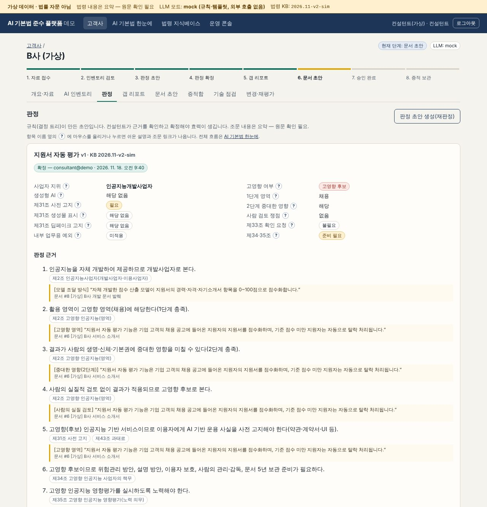

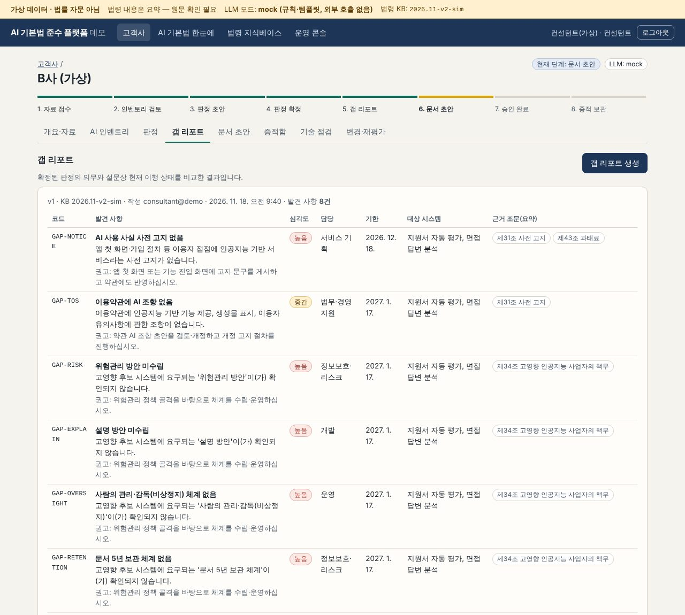

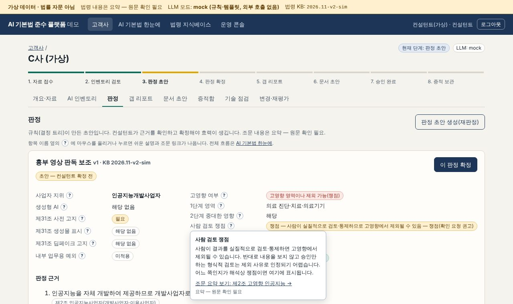

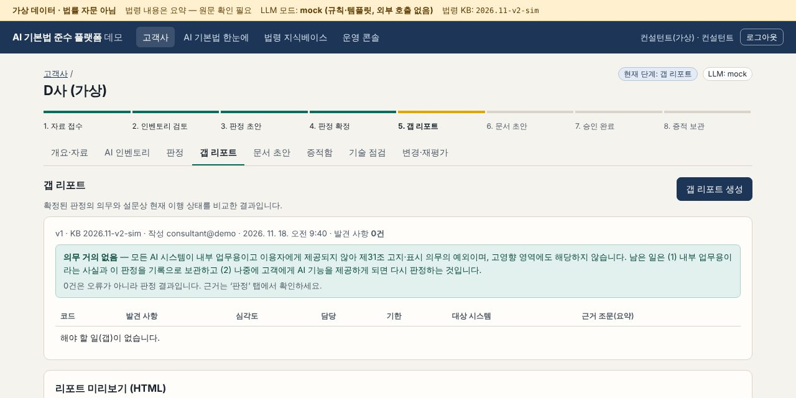

**추천 순서 (한 회사에 5분쯤)**

1. `AI 기본법 한눈에`에서 다섯 가지 질문과 시나리오 표를 먼저 읽습니다.
2. `고객사 등록` → `연습 시나리오로 시작` → **D사** (가장 단순: 의무 없음) → 개요에서 `인벤토리 추출` → `판정 초안 생성` → 판정 탭에서 확정 → `갭 리포트 생성`. 0건과 그 이유를 확인합니다.
3. **E사** → 같은 순서. 판정에서 "제31조 딥페이크 고지: 필요"를 확인합니다.
4. **B사** → 같은 순서. 판정 근거에서 "채용 영역 → 중대한 영향 → 사람 검토 없음"이 조문·원문과 함께 나오는 것, 갭 8건, 문서 초안에 위험관리 정책 골격과 영향평가 체크리스트가 생기는 것을 봅니다.
5. **C사** → 같은 순서. B사와 판정 화면을 나란히 놓고 `사람 검토 쟁점` 줄을 비교합니다.
6. 실험: 같은 시나리오를 한 번 더 등록하면서 설문 답을 바꿔 봅니다(예: E사에서 "생성물 가시 표시"를 "예"로 바꿈 → 갭이 3건에서 2건으로). AI 인벤토리 탭에서 사실을 고치고(예: C사의 `사람의 실질 검토`를 "검토 없음"으로) `판정 초안 생성(재판정)`을 누르면 결과가 고영향 후보로 바뀝니다.

**읽을 때 조심할 것**

- 시나리오의 기대 결과는 **이 데모의 규칙 해석**입니다. 실제 사건의 법적 판단이 아닙니다.
- 시나리오 문서는 mock 추출 규칙이 읽을 수 있게 쓴 글입니다. 실제 고객 문서는 표현이 달라 mock이 틀릴 수 있고, 그때는 AI 인벤토리 탭에서 사람이 고칩니다.
- B~E사는 기술 점검 대상 사이트가 없어 `기술 점검` 탭에서는 안내만 나옵니다(기술 점검 시연은 A사).

## 14. AI 기본법 한눈에와 화면 속 설명

`메뉴: AI 기본법 한눈에`

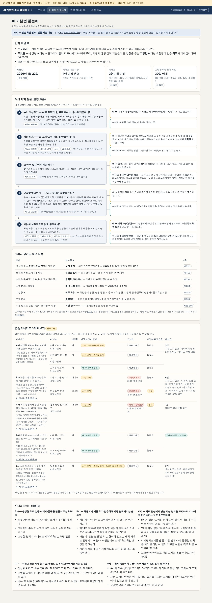

| | |
|---|---|
| **무엇인가** | 법을 처음 보는 사람을 위한 한 페이지 설명. 다섯 가지 질문(누가 대상인가 → 생성형인가 → 고객에게 제공하나 → 고영향 영역인가 → 사람이 실질적으로 검토하나)에 예/아니오로 답하면 어떤 의무가 생기는지 보여 줍니다 |
| **구성** | 세 줄 요약과 핵심 숫자(시행 2026-01-22, 과태료 계도기간 1년 이상, 과태료 3천만원 이하, 확인 요청 회신 30일) → 결정 흐름 → 의무 목록 표 → 시나리오 A~E 결과 표 → 시나리오별 배울 점 |
| **어떻게 쓰나** | 조문 태그를 누르면 법령 지식베이스의 해당 조문 요약으로 이동합니다. 시나리오 표의 `이 시나리오로 등록 →`을 누르면 등록 폼이 그 시나리오로 채워져 열립니다 |
| **주의** | 내용은 법령 지식베이스의 요약만 풀어 쓴 것입니다. **요약 — 원문 확인 필요 · 법률 자문 아님** |

화면 안에도 설명이 붙어 있습니다.

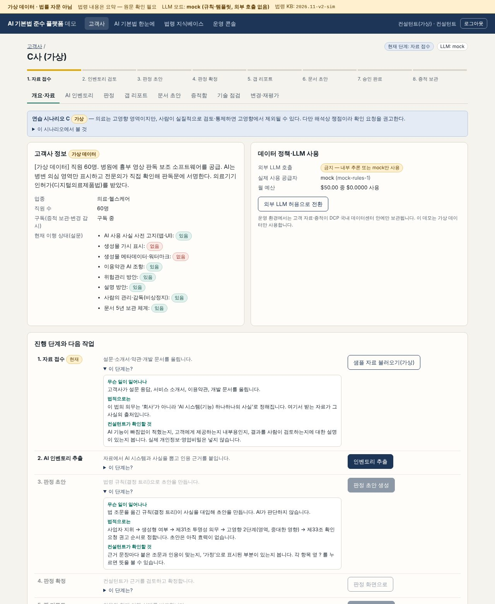

| 위치 | 무엇이 나오나 |
|---|---|
| 개요·자료 → 진행 단계와 다음 작업 | 단계마다 `이 단계는?`을 누르면 **무슨 일이 일어나나 / 법적으로는 / 컨설턴트가 확인할 것** 세 가지가 펼쳐집니다 |
| 판정 | 항목 이름 옆 `?`에 마우스를 올리거나 누르면 그 항목의 뜻과 조문 링크가 나옵니다(사업자 지위, 생성형, 제31조 3가지, 내부 업무용 예외, 고영향 여부·1단계·2단계, 사람 검토 쟁점, 제33조, 제34·35조, 타법 이행 간주) |
| 갭 리포트 | 0건이면 왜 0건인지(예: 내부 업무용 예외) 설명이 나옵니다 |
| 개요·자료 (시나리오 고객) | 맨 위에 그 시나리오에서 볼 것과 예상 갭이 나옵니다 |

---

## 10분 시연 순서

`consultant@demo`로 로그인한 상태에서 시작합니다. A사를 처음부터 보여주려면 개요에서 `샘플 자료 불러오기(가상)`부터 누르세요.

| 시간 | 화면 | 말할 내용 |
|---|---|---|
| 0~1분 | (도입) | "AI 기본법이 1월에 시행됐고, 과태료 계도기간이 끝나면 고지 위반만으로 3천만원입니다. 생성형 AI를 서비스에 쓰는 입주사들이 대상입니다." |
| 1~2분 | 개요·자료 | 가상 고객 A사 소개, 설문상 빨간 "아니오" 항목들 |
| 2~3분 | AI 인벤토리 | "AI가 문서를 읽고 AI 3개를 찾았고, 모든 내용에 출처가 있습니다." |
| 3~5분 | 판정 | 이미지 생성 판정을 펼쳐 근거 조문과 원문을 보여주고, 고객문의 요약의 "내부 업무용 예외"와 대비. "확정은 사람이 합니다." |
| 5~6분 | 갭 리포트 | "고칠 것 3건, 담당·기한까지 나옵니다. 여기까지가 진단 상품입니다." |
| 6~7분 | 문서 초안 | 고지 문구 3종, "근거 미확인" 표시 설명 |
| 7~8분 | 증적함 | `체인 검증` 누르기. "5년 보관을 DCP 센터가 합니다. IDC만 할 수 있는 상품입니다." |
| 8~9분 | 기술 점검·변경 재평가 | "고객이 실제로 고쳤는지 매주 확인하고, 법이 바뀌면 자동으로 다시 봅니다. 이게 구독료입니다." |
| 9~10분 | 운영 콘솔 | 자동화 작업과 비용. "서버 1대와 컨설턴트 1명으로 시작할 수 있습니다." |

## 예상 질문과 답

**Q. AI가 법률 판단을 하는 건가요? 틀리면 책임은?**
아닙니다. 판단은 법 조문을 규칙으로 옮긴 프로그램이 하고, AI는 고객 문서에서 사실을 찾고 문서 초안을 쓰는 역할만 합니다. 최종 확정과 승인은 컨설턴트가 하고, 법령 해석이 필요한 부분은 제휴 로펌이 맡는 구조입니다. 화면에도 "법률 자문 아님"이 항상 표시됩니다.

**Q. 고객 자료가 해외 AI 회사로 넘어가나요?**
외부 AI로 보낼 때는 이름·연락처·번호 같은 개인정보를 가린 뒤 보냅니다. 고객이 원하면 "외부 반출 금지"로 바꿔 외부로 아예 보내지 않을 수 있고, 이 경우 DCP 서버의 내부 모델로 처리합니다. 증적과 원본은 운영 환경에서 DCP 국내 센터에만 보관합니다. (서버 구성은 [`INFRASTRUCTURE.md`](INFRASTRUCTURE.md) 참고)

**Q. 지금 화면의 데이터는 실제인가요?**
모두 가상입니다. A사도, A사 서비스 사이트도, 법령 변경 v2도 시연용으로 만든 것입니다. 법 조문 요약은 공개 자료를 근거로 했지만 원문 확인이 필요합니다.

**Q. mock 모드와 anthropic 모드는 뭐가 다른가요?**
mock은 정해진 규칙과 템플릿으로 답하는 무료 모드이고, anthropic은 Claude Fable 5.2가 실제로 문서를 읽고 씁니다. 판정 규칙은 두 모드가 같고, 인벤토리 추출과 문서 작성의 품질이 달라집니다.

**Q. AI 비용은 얼마나 드나요?**
고객 1곳의 진단·문서 작업에 드는 AI 비용은 매출의 약 6% 수준으로 추정합니다. 운영 콘솔에서 고객별 사용량과 월 예산을 실시간으로 볼 수 있고, 예산을 넘으면 자동으로 멈추거나 무료 모드로 바뀝니다.

**Q. 사업화하려면 무엇이 더 필요한가요?**
파일럿용 서버 1대(기존 1U 서버에 메모리 증설), 파일럿 고객 3곳, 제휴 로펌, 컨설턴트 1명입니다.

---

*같은 내용의 HTML 버전: [`guide/index.html`](guide/index.html) (내려받아 브라우저로 열면 왼쪽 목차가 있는 화면으로 볼 수 있습니다)*
